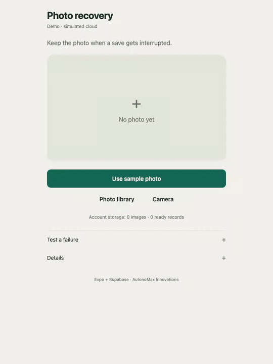
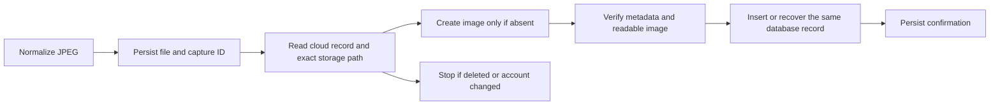

# Expo + Supabase Photo Recovery

**Your upload succeeded. Your app thinks it failed. What happens when you tap Retry?**

A runnable Expo starter for recovering photo saves when an upload, database write, or response fails. It keeps the original JPEG on the device, persists one capture ID, and checks Storage and the database before retrying.



[Watch the failure-to-recovery demo](docs/demo.mp4). The recording uses the explicitly labelled simulated cloud. The same recovery controller also has a real Supabase adapter and tested database policies.

## Try it without credentials

Use Node 24 or newer. This repo targets Expo SDK 57 and React Native 0.86.

```sh
npm ci
npm start
```

Open it in Expo Go for SDK 57. Or run `npm run web` for the browser version. No account or backend is needed for demo mode.

1. Expand **Test a failure** and choose **Lost upload response**.
2. Tap **Use sample photo**, then **Save photo**.
3. Notice **Save unconfirmed**, **1 image**, **0 ready records**.
4. Reload the app. The same capture and pending state remain.
5. Tap **Retry save**. That one action resumes the injected requests and checks the same capture.
6. The result is **Cloud confirmed**, with **1 image** and **1 ready record**.

Also try a rejected database write, lost database response, rejected upload, offline save, account A/B switching, and offline removal. **Details** contains the recovery trace, capture ID, account switch, and soft-removal action. **Photos** keeps older pending captures accessible. The sample artwork is original and synthetic; no product photos or private data are included.

## Connect a separate Supabase project

Use a new project for this starter. Do not run its migration against an existing product database without adapting and reviewing it.

1. Apply [`supabase/migrations/20261011204618_photo_recovery.sql`](supabase/migrations/20261011204618_photo_recovery.sql) through your normal migration workflow or the new project's SQL editor.
2. Enable **Anonymous Sign-Ins** in Supabase Auth. Anonymous users still have an authenticated user ID; ownership policies use that ID.
3. Copy `.env.example` to `.env`. Set the project URL and its **publishable key**. A legacy anon key also works. Never put a service role or secret key in this app.
4. Restart Expo. The header should show **Connected · Supabase**.

```dotenv
EXPO_PUBLIC_SUPABASE_URL=https://YOUR_PROJECT.supabase.co
EXPO_PUBLIC_SUPABASE_PUBLISHABLE_KEY=YOUR_PUBLISHABLE_KEY
```

The migration creates a private `photo-recovery` bucket and an owner-scoped `photo_saves` table. It permits create-only JPEG uploads up to 4 MB. A ready record requires matching, nonempty Storage metadata. Deletion records cannot return to ready, and new reads/uploads are denied for a deleted capture. Broad policies added elsewhere to the same bucket or table can weaken this contract because permissive RLS policies combine with OR.

Anonymous auth keeps the starter easy to run. Replace it with your product's login before adopting it: a new test account or a cleared anonymous session cannot recover the previous account's cloud files. In connected mode, **New test account** creates a different user; it does not switch back to the old anonymous identity.

## How recovery works



- **Identity:** One UUID per capture. Its immutable Storage path is `ownerId/captureId.jpg`. Retry does not choose another name or overwrite the existing object.
- **Partial success:** If Storage succeeded and the database failed, retry uses the existing image and finishes its record. If an acknowledgement was lost, reads reconcile the ambiguous result.
- **Confirmation:** File size, MIME metadata, image readability, and the database record must pass before local confirmation. A failed later verification is shown separately from the earlier confirmation.
- **Account changes:** Every awaited stage checks the account generation. In-flight Supabase requests use the captured bearer token, so switching accounts cannot redirect them to the new account. Already accepted server writes may still finish for the old account.
- **Removal:** A durable local deletion record fences a running save immediately. A cloud deletion record prevents stale retry from recreating a ready record. Failed cloud removal remains retryable.
- **Persistence:** Native files live in the app's document directory; web image bytes live in IndexedDB. AsyncStorage holds small recovery records, not image bytes or signed URLs. Auth session storage is separate from the recovery journal.
- **Deadlines:** Each remote operation has a 20-second wait limit; the SDK fetch also aborts after 20 seconds. A timeout does not prove a server write failed. Image readability checks have a 10-second limit.

Start with [`src/core/recovery.ts`](src/core/recovery.ts), [`src/core/journal.ts`](src/core/journal.ts), and [`src/adapters/supabase.ts`](src/adapters/supabase.ts). The core accepts storage, file, and remote ports and is independent of React Native.

## Test it

```sh
npm run check              # TypeScript + core tests + real PostgreSQL/RLS tests
npm run export:web
npx playwright install chromium
npm run test:web           # Real browser interactions, IndexedDB and page reloads
npm run demo               # Record the labelled demo; requires ffmpeg on PATH
```

Playwright installs its own ffmpeg recorder when installing Chromium. If needed, run `npx playwright install ffmpeg`. `PLAYWRIGHT_CHANNEL=chrome` uses an installed Chrome instead of the bundled browser.

The SQL tests use PGlite to execute the actual migration on PostgreSQL, with minimal local Auth and Storage table definitions. They are not a substitute for testing Supabase's HTTP services.

For the real HTTP integration suite, install Docker and the Supabase CLI, then use this repo's separate local stack:

```sh
supabase start -x realtime,studio,imgproxy,edge-runtime,logflare,vector,supavisor,mailpit,postgres-meta
mkdir -p output
supabase status -o json > output/local-supabase.json
npm run test:supabase
supabase stop
```

The test script refuses hosted URLs and requires the configured local port 54621. It creates synthetic captures and two anonymous local users, checks owner isolation and deletion, and compares signed downloads with the original JPEG bytes. `output/` is ignored and must not be published; local status output contains server credentials as well as public keys. Local Supabase services may bind to network interfaces; stop them when finished.

See [`docs/verification.md`](docs/verification.md) for observed results and remaining device checks. CI runs static/core/SQL/browser checks; local Supabase and native device checks are separate.

## Scope and limits

This is a small application recovery example, with explicit user retries. It is not a background upload service, large-file resumable uploader, general sync engine, or promise of durability after an uninstall, device loss, browser storage eviction, or a capture interrupted before the journal is written. Capture import can leave an unindexed local file if the app exits before writing the journal; no cloud save has begun then.

**Remove is a soft removal, not physical erasure.** The starter retains local image bytes, cloud objects, and deletion records. New signed URLs are blocked after cloud removal, but an already issued URL can remain usable for its 60-second lifetime. A production app needs a server retention/erasure workflow that preserves deletion records and accounts for late accepted uploads. This repo does not supply that workflow.

Metadata and image decoding checks are not a cryptographic proof that an arbitrary pre-existing cloud object has identical bytes. The immutable UUID path and create-only writes are the identity contract. Use hashes and server validation if your product needs stronger integrity guarantees.

Use one foreground recovery controller per app runtime. Concurrent taps are serialized there; this starter does not add cross-process local database locks or automatic multi-device reconciliation. The connected inspector shows up to 100 visible objects/records. Fault controls are developer tools: strip them from a production UI.

## Related tools

[Supabase resumable uploads](https://supabase.com/docs/guides/storage/uploads/resumable-uploads) handle file-transfer resumption. [React Native Upload Queue](https://github.com/erick9125/react-native-upload-queue) provides persistent upload jobs. [PowerSync attachments](https://docs.powersync.com/client-sdks/advanced/attachments) provide a broader attachment/sync system, including a [React Native + Supabase example](https://github.com/powersync-ja/powersync-js/tree/main/demos/react-native-supabase-todolist).

This starter focuses on the application boundary between an Expo photo, Supabase Storage, and its database record, with visible failure injection and executable recovery tests. It is not a claim that Expo or Supabase has an unfixed bug.

Built by [Max Gorriaran](https://github.com/maxgorriaran) / [AutonoMax Innovations](https://autonomaxinnovations.com). MIT licensed. Independently implemented and separate from the CoRoam app.
